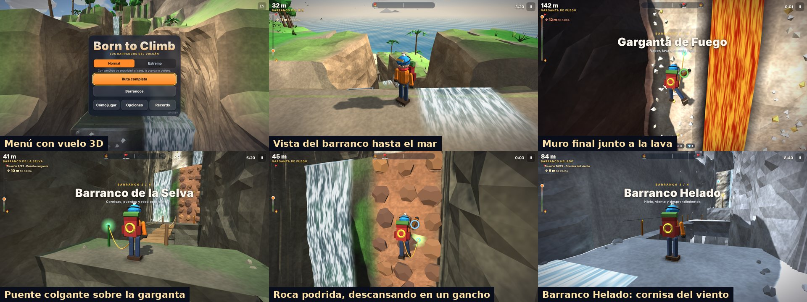

# Born to Climb · v0.4 DEV — Los barrancos del volcán

Juego de escalada 3D para navegador de ERAGames. La ruta sube la cara sur de un volcán por **4 barrancos naturales**: cauces con cascadas, rápidos, pozas profundas, cornisas sobre gargantas y puentes colgantes. Hay 22 desafíos, **ganchos de seguridad** y una **fogata** en lo alto de cada barranco.

**Jugar:** abre `index.html` (es un solo archivo y sirve para itch.io). Con GitHub Pages queda en `…/Rally/escalada/`.



## Qué cambió en la v0.4

- **Barrancos de verdad en lugar de un circuito.** Las paredes son roca curva con relieve, no bloques. Desde lo alto de cada pared se ve el barranco bajando hasta el mar.
- **Saltos más fáciles.** Hay más margen para saltar desde el borde y más control en el aire. Si te quedas corto, **te agarras del borde y subes solo**.
- **Se siente escalar:**
  - las manos y los pies buscan presas reales;
  - el cuerpo sube a tirones, una mano cada vez;
  - cae magnesio y cada agarre suena;
  - cuando te cansas, las manos resbalan y vas bajando.
- **Se siente el peligro:**
  - el HUD indica los metros de caída;
  - mientras más alto estás, la cámara muestra más el vacío;
  - hay cámara lenta cuando la cuerda te frena;
  - suenan latidos y viento según la altura, hay bruma en el fondo de las gargantas y la roca podrida cruje antes de caerse.
- **Interfaz nueva:**
  - anillo de resistencia junto al escalador;
  - título grande al entrar a cada barranco;
  - menú con un vuelo 3D por los barrancos;
  - nombres de los barrancos en los menús.
- Los récords de la v0.3 no se pasan a la v0.4 porque la ruta es distinta. Las opciones y las insignias sí se conservan.

## Cómo se juega

- **Escalar:** mantén Agarrar frente a la **roca clara con presas**. Junto a las cascadas la roca está mojada y lisa, y no se escala.
- **Saltos:** si te quedas corto, te agarras del borde solo. Saltar mientras escalas te impulsa hacia arriba (sirve para las bandas lisas).
- **Ganchos de seguridad:** te enganchas solo al pasar. Si caes, la cuerda te detiene y te sube al último gancho. Si te quedas quieto junto a un gancho de la pared, descansas.
- **Resistencia:** es el anillo junto al escalador. Si se acaba, se te resbalan las manos. Se recupera en suelo firme.
- **Cornisas:** mantén Agarrar para sujetarte del cable cuando sopla el viento.
- **Fogatas:** cierran cada barranco y guardan tu tiempo parcial.
- **Gemas:** hay 10 escondidas fuera del camino directo.
- **Modos:**
  - Normal: con cuerda.
  - Extremo: sin cuerda; si caes, vuelves a la última fogata.
- **Menú:**
  - Ruta completa, o cada barranco por separado (se desbloquean al llegar a su fogata);
  - medallas por tiempo y récords;
  - fantasma de tu mejor subida;
  - insignias.

## Los barrancos (22 desafíos)

| Barranco | Desafíos |
|---|---|
| 1 · del Río | Primera cascada · Rápido de rocas · La cascada · Travesía de la poza · Salto en la pared · Vía ferrata |
| 2 · de la Selva | Cortina de lianas · La cornisa · Puente colgante · Roca podrida · La grieta · Muro de la selva |
| 3 · Helado | Cascada de hielo · Cornisa del viento · Salto con garfio · Desprendimientos · Tirolesa · Doble salto |
| 4 · Garganta de Fuego | Muro de vapor · Rocas de lava · Ceniza suelta · Muro final → cumbre |

**Tipos de pared:**

| Pared | Cómo se escala |
|---|---|
| Roca | Normal |
| Lianas | Cansan menos |
| Hielo | Cansa casi el doble |
| Escalera de hierro | Casi no cansa |
| Roca podrida | Se desmorona por partes: no te detengas |

**Peligros:** ráfagas de viento con aviso, rocas que caen por carriles, chorros de vapor y lava.

La ruta se describe como datos en `src/route.js` (lista `GORGES`). Para cambiar un desafío, su altura o el orden, se edita esa lista. El terreno, las paredes, el río y las cascadas se generan solos alrededor de cada barranco.

## Controles

| | Teclado | Táctil | Mando |
|---|---|---|---|
| Mover | WASD / flechas | Joystick (mitad izquierda) | Stick izquierdo |
| Cámara | Ratón (clic para capturar) | Arrastrar a la derecha | Stick derecho |
| Saltar / impulso | Espacio | SALTAR | A |
| Agarrar / escalar / cable | Mantener clic izq. o F | AGARRAR | RT / RB |
| Correr | Shift | CORRER (alterna) | LT / L3 |
| Garfio / tirolesa | E | USAR (aparece cuando se puede) | X |
| Pausa | Esc / P | II | Start |

## Estructura

Se edita en `src/` y se reconstruye. **Nunca se edita `index.html` a mano.**

```
escalada/
  index.src.html   HTML + CSS de menús, HUD y controles táctiles
  build.py         une todo en index.html (un solo archivo)
  src/
    three.min.js   Three.js r149 (MIT), copia local
    util.js        aleatorio con semilla, ruido, guardado seguro
    config.js      valores de ajuste (movimiento, saltos, resistencia, tipos de pared) e insignias
    i18n.js        textos ES/EN
    route.js       los 4 barrancos (GORGES) y el constructor de desafíos
    world.js       isla, barrancos tallados, paredes de roca (franjas), bloques orientados, peligros
    player.js      movimiento, agarre de bordes, escalada en roca curva, cuerda, garfio y tirolesa
    render.js      núcleo del dibujo: luces, cielo, terreno, personaje (manos sobre presas), partículas
    scenery.js     mar, nubes, islas, vegetación con viento, rocas, campamentos y aves
    routegfx.js    paredes, cascadas, río y pozas, presas, lianas, roca podrida, ganchos, cuerda, gemas
    audio.js       efectos, cascadas, viento, latidos y música con WebAudio
    input.js       teclado, ratón, táctil y mando
    ui.js          menús y HUD (anillo de resistencia, metros de caída, títulos)
    main.js        modos, bucle con paso fijo, cámara, fogatas, caídas, peligros, guardado
```

Para reconstruir: `python3 build.py`. Para desarrollar sin reconstruir se puede abrir `index.src.html`.

## Ajustar

En **Opciones → Panel de ajuste (desarrollo)** hay deslizadores para:

- velocidad, salto y gravedad;
- escalada e impulso;
- costos de resistencia;
- descanso en ganchos;
- distancia de enganche.

Cuando encuentres buenos valores en el iPad, pásalos a `src/config.js`.
