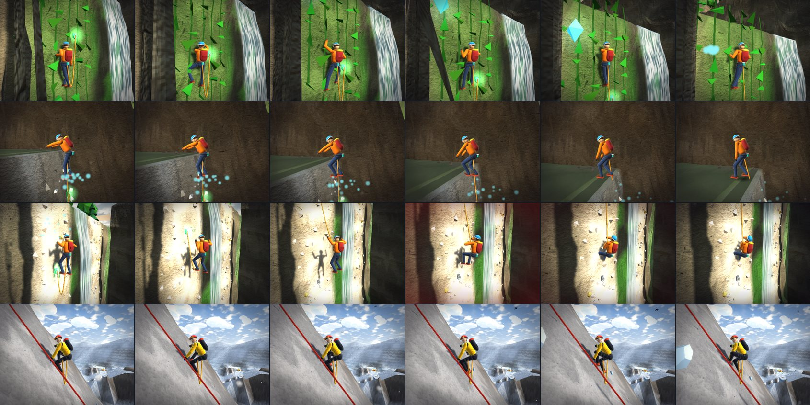

# Born to Climb · v0.9 DEV — Expedición al Gigante Blanco

Juego de escalada 3D para navegador de ERAGames. En el menú eliges entre dos montañas:

- **🌋 Volcán:** la ruta sube la cara sur por **4 barrancos** con cascadas, lianas y lava. Tiene 22 desafíos, ganchos de seguridad y una fogata al final de cada barranco. Es la misma ruta de la v0.4.
- **🏔️ Gigante Blanco (nuevo):** una expedición por la nieve al estilo K2. Subes del campamento base a la cumbre por **5 tramos** y **19 desafíos**:
  - cascada de hielo con grietas y escaleras de aluminio;
  - laderas con cuerda fija roja;
  - banda de roca y arista del hombro;
  - el cuello de botella, donde caen bloques de hielo.

  Hay 4 campamentos de altura en el camino, ventiscas y otros escaladores de la expedición que suben contigo.

**Jugar:** abre `index.html` (es un solo archivo y sirve para itch.io). Con GitHub Pages queda en `…/Rally/escalada/`.



## Qué cambió en la v0.9: pulido en movimiento

Revisé al escalador cuadro a cuadro, en secuencias: escalar, caminar, correr, saltar, salir arriba, caer con cuerda, jumar y escalera.

- **Ganchos en cada columna:** en las paredes con dos columnas escalables y cascada en medio (la pared grande, el segundo salto y el muro final del volcán), cada columna tiene gancho a cada altura. Antes estaban alternados, y si subías por una sola columna la caída podía llegar hasta el suelo.
- **Salir arriba de una pared:** las manos se quedan en la orilla mientras el cuerpo pasa encima, primero el pecho y luego la rodilla. Antes el escalador "aparecía" de pie.
- **Cámara un poco más cerca:** el escalador nuevo es más delgado.
- **Sonido de magnesio** al meter la mano en la bolsa mientras descansas.

## Qué cambió en la v0.8: el escalador nuevo

- **Cuerpo con articulaciones:** cadera, columna, cuello, hombros, codos y rodillas. Tiene proporciones de persona, en vez del muñeco de bloques.
- **Equipo:**
  - casco con lámpara;
  - arnés con mosquetones y cintas exprés que se mecen;
  - bolsa de magnesio;
  - mochila con la cuerda enrollada;
  - bandana que ondea.
  - En la nieve: traje de pluma acolchado, capucha con piel, gafas y crampones.
- **Cara:** ojos que parpadean, cejas que se fruncen con el esfuerzo y boca que jadea cuando estás cansado.
- **Cinemática inversa (IK) de dos huesos:**
  - las manos van a las presas reales de la pared, y los pies a las presas de pie;
  - al caminar, cada pie pisa la altura real del terreno;
  - en la cuerda fija una mano va en la cuerda; en la escalera, en la cuerda de mano.
- **Expresión corporal:**
  - mira la presa que va a agarrar y gira la cadera hacia la mano que alcanza;
  - le tiemblan los brazos cuando se cansa;
  - en los ganchos sacude el brazo y mete la mano en la bolsa de magnesio, con nubecita blanca;
  - de pie respira, cambia el peso de pie y mira alrededor; a veces voltea a la cámara;
  - agotado pone las manos en las rodillas; con frío se abraza;
  - se agacha al aterrizar;
  - colgado de la cuerda se sienta en el arnés;
  - frena boca abajo con el piolet;
  - celebra en la cumbre.
- **Los escaladores de la expedición** tienen el mismo estilo (torso, casco, gafas, mochila) y siguen dibujándose con instancias, en pocas llamadas.

## Qué cambió en la v0.7 (gráficos)

- **Postproceso propio** (calidad media y alta), sin bibliotecas: está en `src/post.js`.
  - **Brillo (bloom):** brillan el sol, la lava, los faroles, las chispas y el agua iluminada. La arena y la nieve claras casi no brillan, para no lavar la imagen.
  - **Rayos de sol:** se cuelan entre las orillas, los árboles y las aristas cuando miras hacia el sol.
  - **Color de cine:** contraste suave, saturación que respeta lo ya saturado, sombras un poco frías y luces cálidas. En la nieve es más frío y brilla menos.
  - **Viñeta y suavizado de bordes (FXAA).**
- **Pastizal de verdad alrededor del jugador** (`src/grassfield.js`):
  - miles de briznas en mosaicos que se reacomodan al caminar;
  - toman el color del suelo, se mecen con ráfagas de viento y se apartan cuando pasas;
  - se encogen en el borde para que no se note dónde termina el campo.
- **Cielo nuevo:**
  - sol con disco, corona y halo;
  - bruma cálida en el horizonte del lado del sol;
  - nubes en dos capas, con sombra propia y borde plateado hacia el sol.
- **Luz de contorno** en el escalador y en la expedición: la silueta toma el color del cielo y resalta contra el fondo.
- **Polen y polvo flotando** en el volcán, encendidos por el sol.
- **El pasto y las hojas de dos caras** ya no salen negros por detrás.
- **Protección de rendimiento:** si el aparato no llega a ~42 cuadros por segundo, el juego baja solo la resolución interna. Si aun así no alcanza, apaga el postproceso. La calidad baja queda como antes.

## Qué cambió en la v0.6

**Arreglos para que se pueda terminar.** Encontrados con un bot honesto: antes el bot rellenaba la resistencia y no detectaba estos problemas.

- **Laderas con cuerda fija:** subir costaba más que una barra de resistencia, y colgado de la cuerda no recuperabas, así que entrabas en un ciclo infinito de soltarte y volver a agarrarte. Ahora:
  - quieto en la cuerda, manteniendo AGARRAR, descansas;
  - si te quedas sin fuerzas, te quedas colgado recuperando en vez de caer;
  - subir cansa menos.
- **Al pie y en lo alto de la cuerda:** había dos atascos. Uno te enganchaba y desenganchaba sin parar al pie; el otro no te dejaba salir arriba si llegabas de lado. Los dos quedaron arreglados.
- **Cuello de botella:** no había ningún lugar seguro para esquivar los bloques de hielo. Ahora caen por turnos, a un lado y al otro de la cuerda: muévete al otro lado cuando veas soltarse la nieve arriba.
- **Agotado:** ya no puedes volver a agarrarte de la pared con 15 % de resistencia para caerte otra vez. Recuperas la mitad en el suelo y sigues.
- **Pared de hielo de 9 m:** tiene dos ganchos de descanso en vez de uno.
- **Frío más ligero:** sube más lento y castiga menos la resistencia.
- **Piolet:**
  - ya no se activa por error en el volcán, donde te dejaba flotando junto a la pared;
  - en Extremo ahora sí frena.
- **Verificado:** las dos montañas se completan sin trampas, aun llegando cansado y con frío.

**Gráficos.**

- **Textura de materiales generada en el juego:** pasto con briznas y manchas, roca con grietas y estratos, lechos con piedritas, arena con rizos y nieve con ondas de viento y brillos.
- **Relieve con la luz:** la luz marca el relieve de cada material.
- **Sombreado suave en el terreno:** quita el aspecto de triángulos planos.
- **Orillas de los barrancos:** la tapa de cada pared toma el color del terreno, y ya no asoman triángulos negros que parecían hoyos.
- **Garganta de Fuego:** ya no sale nieve en el fondo, y las grietas de lava son fisuras en zigzag que brillan.
- **Atardecer:** tiene más luz ambiental, para que el fondo de los barrancos no quede negro.

## Qué cambió en la v0.5

- **Segunda montaña: el Gigante Blanco.** Es una pirámide de nieve con aristas, bandas de roca y un glaciar al pie. Abajo hay un mar de nubes y alrededor, cordilleras lejanas. Cada campamento tiene su letrero flotante (Campamento Base, Campos 1 a 4 y Cumbre).
- **Cuerdas fijas rojas.**
  - Te enganchas solo al pasar.
  - En las laderas muy empinadas, mantén **Agarrar** para subir jalándote de la cuerda (jumar).
  - Si sueltas, la cuerda te detiene y te vuelves a sujetar.
- **Escaleras de aluminio** sobre las grietas y por las paredes de hielo (seracs). Sobre la escalera caminas más lento y la cámara se mece. Si caes, la cuerda de mano te sostiene.
- **Piolet.** Si resbalas por la nieve sin una cuerda que te asegure, mantén **Agarrar** para frenar. Te sostiene mientras te quede resistencia.
- **Ventiscas y frío.**
  - El clima cambia solo: calma, se acerca la ventisca, ventisca y luego amaina.
  - En la ventisca casi no se ve y el viento te empuja. La cuerda roja brilla para que la sigas.
  - El frío sube con la altura y con la ventisca. Con frío te cansas más y recuperas menos.
  - Te calientas junto al farol de cada campamento.
  - No hay comida ni oxígeno que administrar.
- **Bloques de hielo** que bajan por carriles en el cuello de botella. Antes de que caigan se suelta nieve arriba: cámbiate de carril.
- **Escaladores de la IA.** Seis miembros de la expedición (Nima, Ana, Dawa, Lucía, Pemba y Tomás) suben la misma ruta:
  - caminan, cruzan escaleras, suben por las cuerdas fijas y escalan;
  - descansan en los campamentos y esperan si alguien les tapa el paso;
  - te saludan cuando llegas a un campamento donde están descansando.
- **Menú:** eliges la montaña en el selector. Cada montaña tiene sus tramos, récords, gemas y fantasma. Hay 4 insignias nuevas del Gigante Blanco.
- **Tus récords del volcán se conservan.** La ruta del volcán no cambió, verificado: el terreno, las paredes y los ganchos salen idénticos a los de la v0.4.

## Cómo se juega

- **Escalar:** mantén Agarrar frente a la **roca clara con presas**. Junto a las cascadas la roca está mojada y lisa, y no se escala.
- **Saltos:** si te quedas corto, te agarras del borde solo. Saltar mientras escalas te impulsa hacia arriba (sirve para las bandas lisas).
- **Ganchos de seguridad:** te enganchas solo al pasar. Si caes, la cuerda te detiene y te sube al último gancho. Si te quedas quieto junto a un gancho de la pared, descansas.
- **Resistencia:** es el anillo junto al escalador. Si se acaba, se te resbalan las manos. Se recupera en suelo firme.
- **Cornisas:** mantén Agarrar para sujetarte del cable cuando sopla el viento.
- **Fogatas:** cierran cada barranco y guardan tu tiempo parcial.
- **Gemas:** hay 10 escondidas fuera del camino directo.
- **Modos:**
  - Normal: con cuerda.
  - Extremo: sin cuerda; si caes, vuelves a la última fogata.
- **Menú:**
  - Ruta completa, o cada barranco por separado (se desbloquean al llegar a su fogata);
  - medallas por tiempo y récords;
  - fantasma de tu mejor subida;
  - insignias.

### En el Gigante Blanco

- **Cuerda fija:** te enganchas solo. En las laderas empinadas, mantén Agarrar para subir por la cuerda; si sueltas, la cuerda te detiene. Quieto en la cuerda (sin soltar Agarrar) descansas.
- **Bloques de hielo:** en el cuello de botella caen por turnos a cada lado de la cuerda. Muévete de lado en la cuerda hacia el lado contrario.
- **Escaleras:** camina despacio. Si caes, te sostiene la cuerda de mano y vuelves a la escalera.
- **Piolet:** si resbalas sin cuerda que te asegure, mantén Agarrar para frenar.
- **Frío:** la barra azul de frío aparece junto a la de altura. Se quita junto al farol de un campamento.
- **Ventisca:** el aviso «Ventisca» aparece abajo. Sigue la cuerda roja hasta el siguiente campamento.
- **Gemas:** hay 6, fuera del camino directo (por ejemplo, debajo de las escaleras).
- **Extremo:** puedes subir por las cuerdas fijas, pero no te aseguran. Si caes, solo te salva el piolet; si no, vuelves al último campamento.

## Volcán: los barrancos (22 desafíos)

| Barranco | Desafíos |
|---|---|
| 1 · del Río | Primera cascada · Rápido de rocas · La cascada · Travesía de la poza · Salto en la pared · Vía ferrata |
| 2 · de la Selva | Cortina de lianas · La cornisa · Puente colgante · Roca podrida · La grieta · Muro de la selva |
| 3 · Helado | Cascada de hielo · Cornisa del viento · Salto con garfio · Desprendimientos · Tirolesa · Doble salto |
| 4 · Garganta de Fuego | Muro de vapor · Rocas de lava · Ceniza suelta · Muro final → cumbre |

**Tipos de pared:**

| Pared | Cómo se escala |
|---|---|
| Roca | Normal |
| Lianas | Cansan menos |
| Hielo | Cansa casi el doble |
| Escalera de hierro | Casi no cansa |
| Roca podrida | Se desmorona por partes: no te detengas |

**Peligros:** ráfagas de viento con aviso, rocas que caen por carriles, chorros de vapor y lava.

## Gigante Blanco: los tramos (19 desafíos)

| Tramo | Desafíos |
|---|---|
| 1 · La cascada de hielo | Escalera sobre la grieta · Serac con escalera · Salto de grieta · Escalera doble · Pared de hielo |
| 2 · La gran ladera | La gran ladera · La rimaya · Ladera del viento |
| 3 · La banda de roca | La banda de roca · La chimenea · Canal de hielo · Muro mixto |
| 4 · El hombro | La arista del hombro · Grieta del hombro · Pala de nieve |
| 5 · El cuello de botella | El cuello de botella · Travesía bajo el serac · Último muro · Arista de la cumbre → cumbre |

Las rutas se describen como datos: el volcán en `src/route.js` (lista `GORGES`) y el Gigante Blanco en `src/k2route.js` (lista `K2_SECTIONS`). Para cambiar un desafío, su altura o el orden, se edita esa lista. El terreno, las paredes, el río, las cascadas, las cuerdas fijas y el camino de la IA se generan solos alrededor de la ruta.

## Controles

| | Teclado | Táctil | Mando |
|---|---|---|---|
| Mover | WASD / flechas | Joystick (mitad izquierda) | Stick izquierdo |
| Cámara | Ratón (clic para capturar) | Arrastrar a la derecha | Stick derecho |
| Saltar / impulso | Espacio | SALTAR | A |
| Agarrar / escalar / cable / cuerda fija / piolet | Mantener clic izq. o F | AGARRAR | RT / RB |
| Correr | Shift | CORRER (alterna) | LT / L3 |
| Garfio / tirolesa | E | USAR (aparece cuando se puede) | X |
| Pausa | Esc / P | II | Start |

## Estructura

Se edita en `src/` y se reconstruye. **Nunca se edita `index.html` a mano.**

```
escalada/
  index.src.html   HTML + CSS de menús, HUD y controles táctiles
  build.py         une todo en index.html (un solo archivo)
  src/
    three.min.js   Three.js r149 (MIT), copia local
    util.js        aleatorio con semilla, ruido, guardado seguro
    config.js      valores de ajuste (movimiento, saltos, resistencia, tipos de pared) e insignias
    i18n.js        textos ES/EN
    route.js       los 4 barrancos del volcán (GORGES) y el constructor de desafíos (común a las dos montañas)
    k2route.js     los 5 tramos del Gigante Blanco (K2_SECTIONS) y sus desafíos: escaleras, laderas, aristas, seracs
    mountains.js   lista de montañas (semilla, tamaño del mapa, zonas, campamentos)
    world.js       terreno, barrancos tallados, paredes de roca (franjas), bloques orientados, peligros
    k2world.js     forma de la montaña de nieve, cuerdas fijas, carriles de bloques de hielo, camino de la IA
    player.js      movimiento, agarre de bordes, escalada, cuerda, garfio, tirolesa, cuerda fija, piolet, frío
    npc.js         escaladores de la IA de la expedición
    render.js      núcleo del dibujo: luces, cielo, terreno, personaje (manos sobre presas), partículas
    scenery.js     mar, nubes, islas, vegetación con viento, rocas, campamentos y aves
    routegfx.js    paredes, cascadas, río y pozas, presas, lianas, roca podrida, ganchos, cuerda, gemas
    k2gfx.js       gráficos de la nieve: mar de nubes, cordilleras, cuerdas fijas, escaleras, letreros, tiendas, IA
    post.js        postproceso: brillo, rayos de sol, color de cine, viñeta y FXAA
    grassfield.js  pastizal denso alrededor del jugador y polen flotando
    climber.js     el escalador: modelo con articulaciones, IK de dos huesos y poses por estado
    audio.js       efectos, cascadas, viento, latidos y música con WebAudio
    input.js       teclado, ratón, táctil y mando
    ui.js          menús y HUD (selector de montaña, anillo de resistencia, metros de caída, frío, ventisca)
    main.js        montañas y modos, bucle con paso fijo, cámara, campamentos, caídas, peligros, clima, guardado
```

Para reconstruir: `python3 build.py`. Para desarrollar sin reconstruir se puede abrir `index.src.html`.

## Ajustar

En **Opciones → Panel de ajuste (desarrollo)** hay deslizadores para:

- velocidad, salto y gravedad;
- escalada e impulso;
- costos de resistencia;
- descanso en ganchos;
- distancia de enganche.

Cuando encuentres buenos valores en el iPad, pásalos a `src/config.js`.
