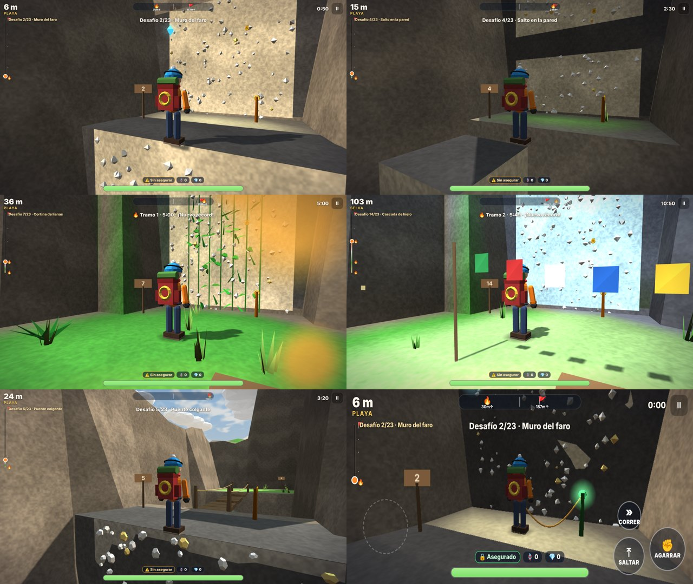

# Born to Climb · v0.3 DEV — La ruta del volcán

Juego de escalada 3D para navegador de ERAGames. Una **ruta fija diseñada a mano** sube la cara sur de un volcán en zigzag: 23 desafíos de escalada repartidos en 4 tramos, con **ganchos de seguridad** y **fogatas** como puntos de control.

**Jugar:** abre `index.html` (un solo archivo, sirve para itch.io). Con GitHub Pages queda en `…/Rally/escalada/`.



## Cómo se juega

- **Escalar:** mantén Agarrar frente a la **roca clara con presas**. La **roca oscura y lisa** no se escala.
- **Impulso:** salta mientras escalas para pasar las bandas lisas.
- **Ganchos de seguridad:** te enganchas solo al pasar junto a uno. Si caes, la cuerda te detiene, quedas colgando y te sube al último gancho. Si te quedas quieto junto a un gancho en la pared, descansas.
- **Resistencia:** escalar, saltar y correr la gastan; se recupera en suelo firme.
- **Fogatas:** se encienden al llegar, cierran el tramo y guardan tu tiempo parcial.
- **Gemas:** hay 9 escondidas fuera del camino directo.
- **Modos:** Normal (con cuerda) y Extremo (sin cuerda: si caes, vuelves a la última fogata).
- **Menú:** Ruta completa, o cada tramo por separado (se desbloquean al llegar a su fogata). Medallas por tiempo, récords, fantasma de tu mejor subida e insignias.

## La ruta (23 desafíos)

| Tramo | Desafíos |
|---|---|
| 1 · Playa | Primer muro · Muro del faro · Pilares de la playa · Salto en la pared · Puente colgante · Vía ferrata |
| 2 · Selva | Cortina de lianas · Travesía del barranco · Plataformas móviles · Roca podrida · Muro de la selva · La chimenea · Escalones de piedra |
| 3 · Alpes | Cascada de hielo · Arista del viento · Salto con garfio · Desprendimientos · Tirolesa · Doble salto |
| 4 · Caldera | Muro de vapor · Pilares de lava · Ceniza suelta · Muro final → cumbre |

Tipos de pared: roca (normal), lianas (cansan menos), hielo (casi el doble), escalera de hierro (casi no cansa), roca que se desmorona (no te detengas). Peligros: ráfagas de viento con aviso, rocas que caen por carriles, chorros de vapor y lava.

La ruta se describe como datos en `src/route.js` (lista `ROUTE`). Para cambiar un desafío, su altura o el orden, se edita esa lista; el terreno se talla solo alrededor de la ruta.

## Controles

| | Teclado | Táctil | Mando |
|---|---|---|---|
| Mover | WASD / flechas | Joystick (mitad izquierda) | Stick izquierdo |
| Cámara | Ratón (clic para capturar) | Arrastrar a la derecha | Stick derecho |
| Saltar / impulso | Espacio | SALTAR | A |
| Agarrar / escalar | Mantener clic izq. o F | AGARRAR | RT / RB |
| Correr | Shift | CORRER (alterna) | LT / L3 |
| Garfio / tirolesa | E | USAR (aparece cuando se puede) | X |
| Pausa | Esc / P | II | Start |

## Estructura

Se edita en `src/` y se reconstruye. **Nunca se edita `index.html` a mano.**

```
escalada/
  index.src.html   HTML + CSS de menús, HUD y controles táctiles
  build.py         une todo en index.html (un solo archivo)
  src/
    three.min.js   Three.js r149 (MIT), copia local
    util.js        aleatorio con semilla, ruido, guardado seguro
    config.js      valores de ajuste (movimiento, resistencia, tipos de pared) e insignias
    i18n.js        textos ES/EN
    route.js       la ruta diseñada (ROUTE) y el constructor de desafíos
    world.js       isla, tallado del pasillo, bloques, caras escalables, plataformas y derrumbes
    player.js      movimiento, escalada en bloques, cuerda de seguridad, garfio y tirolesa
    render.js      núcleo del dibujo: luces, cielo, terreno, personaje, partículas
    scenery.js     agua, nubes, islas, vegetación con viento, rocas, campamentos y aves
    routegfx.js    dibujo de la ruta: bloques, presas, escaleras, lianas, ganchos, cuerda, gemas
    audio.js       efectos y música con WebAudio
    input.js       teclado, ratón, táctil y mando
    ui.js          menús y HUD
    main.js        modos, bucle con paso fijo, cámara, fogatas, caídas, peligros, guardado
```

Reconstruir: `python3 build.py`. Para desarrollar sin reconstruir se puede abrir `index.src.html`.

## Ajustar

En **Opciones → Panel de ajuste (desarrollo)** hay deslizadores de velocidad, salto, gravedad, escalada, impulso, costos de resistencia, descanso en ganchos y distancia de enganche. Cuando encuentres buenos valores en el iPad, pásalos a `src/config.js`.
