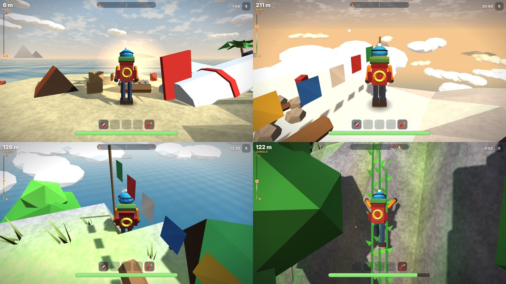

# Born to Climb · v0.2 DEV

Juego de escalada en 3D para navegador, estilo PEAK, de ERAGames. Hay que subir una isla volcánica, desde la playa hasta la cumbre, y disparar la bengala.

**Jugar:** abre `index.html`. Con GitHub Pages queda en `…/Rally/escalada/`.



## Qué tiene

- **Cuatro biomas** por altura: Playa → Selva → Alpes → Caldera. La cumbre está en el borde del cráter, a unos 290–300 m.
- **Montaña del día**: la misma isla para todos en la misma fecha. También hay montañas aleatorias.
- **Escalada con resistencia**: la barra se gasta al correr, saltar y escalar, y se recupera en suelo firme. Saltar en la pared te impulsa hacia arriba.
- **Afecciones** que se comen la barra (como en PEAK): hambre, heridas por caída, frío en los Alpes y veneno de las bayas misteriosas. Si llenan la barra, te desmayas.
- **Objetos** (4 espacios y la bengala fija): coco, bayas, barra de granola, vendaje, botiquín, bebida energética, termo de té, hierba antídoto y clavos de escalada para descansar en la pared.
- **Maletas del avión** con botín, **arbustos de bayas** y **cocos**.
- **Fogatas**: son puntos de control. Se encienden, quitan el frío y permiten asar un malvavisco.
- **Peligros**: tormentas de nieve con viento en los Alpes, fumarolas que avisan y luego estallan, y el lago de lava.
- **Modos**: Normal (despiertas en la última fogata) y Extremo (una sola vida).
- **Lianas** en la selva (gastan menos de la mitad y se suben más rápido) y **hielo** en los Alpes (casi el doble).
- **Garfio**: mira una pared alta (aparece una marca verde) y te lanza hasta ella.
- **Brújula** arriba con la próxima fogata 🔥 y la cumbre 🚩. Caer en nieve o arena duele menos, y junto a la fogata te curas.
- **Fantasma** de tu mejor subida en cada montaña y **11 insignias**.
- Ciclo de día de la mañana al atardecer, medallas por tiempo, récords por montaña y pistas contextuales.
- Controles: táctil (joystick, cámara, Agarrar mantener/alternar, multitouch), teclado + ratón y mando.
- Bilingüe español/inglés, tres niveles de calidad, audio sintetizado (sin archivos) y panel de ajuste en vivo.

## Gráficos (v0.2)

- Terreno con grano triplanar, vetas en los acantilados, nieve nítida en las repisas, sombreado en grietas y paredes de hielo.
- Agua con profundidad (turquesa en lo bajo), espuma en la orilla, cáusticas y reflejo del sol.
- Mar de nubes alrededor de la montaña, nubes en el cielo e islas en el horizonte.
- Pasto, flores, helechos y árboles que se mecen con el viento; gaviotas y águilas; tiendas y banderines en los campamentos.
- Personaje nuevo (bufanda, cuerda, lentes, cara), vaho con el frío, magnesio al agarrarse, polen en la selva y ceniza en la caldera.
- Sombras también en calidad media. La vegetación se recorta por zonas y por distancia para que aguante en iPhone.

## Controles

| | Teclado | Táctil | Mando |
|---|---|---|---|
| Mover | WASD / flechas | Joystick (mitad izquierda) | Stick izquierdo |
| Cámara | Ratón (clic para capturar) | Arrastrar a la derecha | Stick derecho |
| Saltar | Espacio | SALTAR | A |
| Agarrar / escalar | Mantener clic izq. o F | AGARRAR | RT / RB |
| Correr | Shift | CORRER (alterna) | LT / L3 |
| Usar / recoger | E | USAR (aparece cuando hay algo) | X |
| Objetos | 1–4 (Shift+número suelta) | Tocar (mantener suelta) | Cruceta |
| Pausa | Esc / P | II | Start |

## Estructura

Se edita en `src/` y se reconstruye. **Nunca se edita `index.html` a mano.**

```
escalada/
  index.src.html   HTML + CSS de menús, HUD y controles táctiles
  build.py         une todo en index.html (un solo archivo, sirve para itch.io)
  src/
    three.min.js   Three.js r149 (MIT), copia local
    util.js        aleatorio con semilla, ruido, guardado seguro
    config.js      TODOS los valores de ajuste, objetos y botín
    i18n.js        textos ES/EN
    world.js       generación de la isla, consultas de altura y normales, colocación
    player.js      movimiento, escalada, resistencia y afecciones (sin Three.js)
    render.js      núcleo del dibujo: luces, cielo, terreno, objetos, personaje, partículas
    scenery.js     agua, nubes, islas, vegetación con viento, rocas, lianas, campamentos y aves
    audio.js       efectos y música con WebAudio
    input.js       teclado, ratón, táctil y mando
    ui.js          menús y HUD
    main.js        estados, bucle con paso fijo, cámara, clima, objetos, guardado
```

Reconstruir:

```
python3 build.py
```

Para desarrollar sin reconstruir puedes abrir `index.src.html` directamente: carga los módulos por separado.

## Ajustar el manejo

En **Opciones → Panel de ajuste (desarrollo)** salen deslizadores de velocidad, salto, gravedad, escalada, costos de resistencia, daño por caída, hambre y frío. Pruébalos en el iPad y, cuando encuentres valores buenos, pásalos a `src/config.js`. Viene apagado por defecto.
